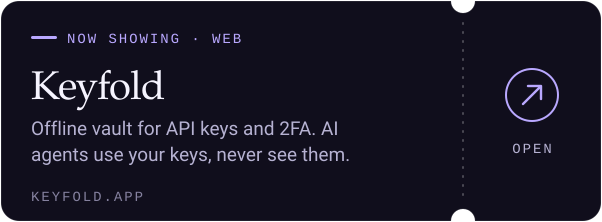
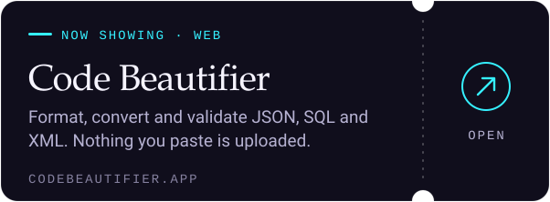
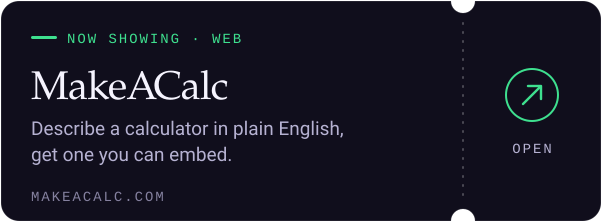
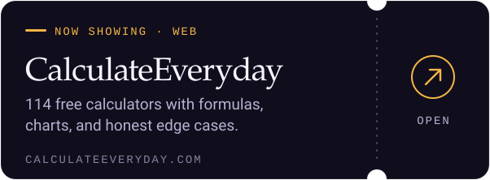
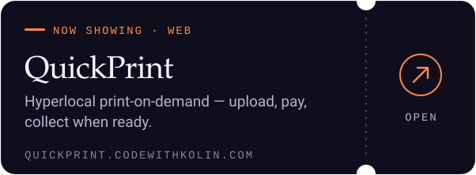
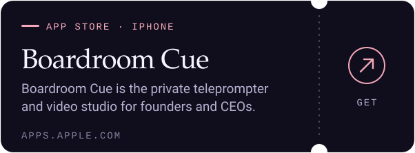

<!-- Rebuilt every night by build.mjs. Edit data/story.json, not this file. -->

<a href="https://codewithkolin.com">Story</a> · <a href="https://codewithkolin.com/projects">Work</a> · <a href="https://codewithkolin.com/ledger">Log</a> · <a href="https://codewithkolin.com/hire">Hire</a> · <a href="https://courses.codewithkolin.com">Courses</a> · <a href="https://www.youtube.com/@codewithkolin">YouTube</a> · <a href="https://x.com/CodeWithKolin">X</a> · <a href="https://www.instagram.com/codewithkolin">Instagram</a> · <a href="https://www.linkedin.com/in/codewithkolin/">LinkedIn</a>

Tonight's cut: 14 Nov 2026 · last shipped keyfold · 1,793 contributions in the last year. Redrawn every night from live data by <a href="build.mjs">one script</a>.

